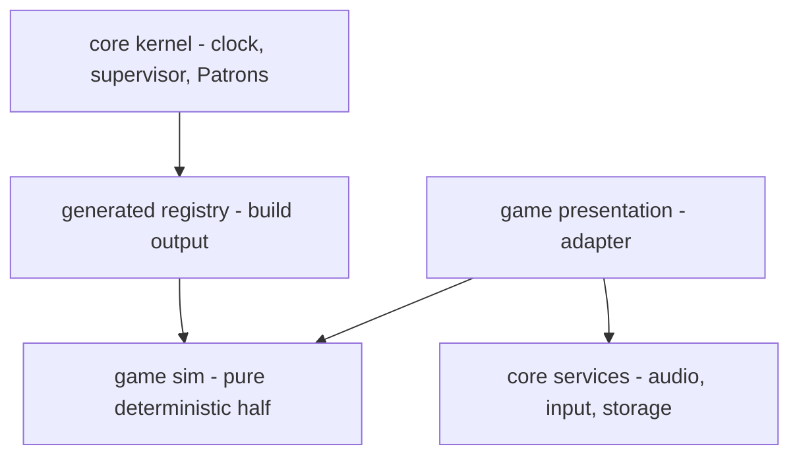
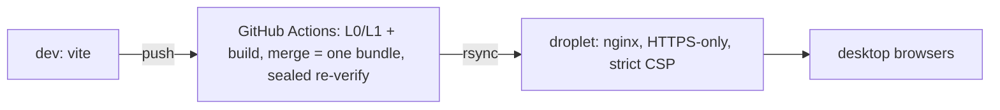

# Local Arcade — How the Thing Is Put Together

This is the prose companion to the Architecture Spine. The spine is the binding contract — rules, IDs, diagrams. This document is the *why*: the road not taken, the push-back in review, the moments where we changed our minds. Read it before opening epics, and read the spine while building.

## 1. The idea, and the three laws it serves

Local Arcade is a first-person, walk-in 3D arcade on the open web. You enter through the front door, find a game the way you did as a kid — by ear — and sit down to a real, complete game. Every machine was built by local LLMs *at build time*; at runtime nothing thinks, nothing phoned home, and the whole room is a reproducible recording. The thesis: local models as builders, not chatbots.

Three laws drive every decision, and they pull in different directions on purpose:

1. **Patrons really play.** A "busy" cabinet isn't a looping animation — a Patron is a real autoplay run of that game, and its reactions are caused by that game's own events.
2. **CI verifies in seconds.** A game can be checked for determinism and life headlessly, no browser, in the time it takes to push.
3. **Sound guides you.** Discovery is occluded attract-mode audio pulling you through the room — zero menus, zero hints.

Midway through design we paused on a fair question: *am I making this too complex? I just want an arcade I can install games into.* The resolution held: the ledger, the manifest, and the one-build pipeline **are** the install experience — the ceremony lives in the factory, not in your evenings. Core complexity is one-time (milestones M0–M2); every game after is thin: a sim, an adapter, a manifest. We proceeded.

## 2. The mental model: a kernel, two-part games, and a ledger

**The Arcade Core is a kernel.** Think of it as the arcade building's electrical system: the walls provide power sockets of one standard, and any appliance that fits the plug works. The kernel owns the clock, the room, and every shared service — audio, input, storage, Patrons. A game registers by paperwork alone; no core code changes, ever (AD-1). We considered a full ECS framework instead, and declined it: ECS taxes every independent Game epic with framework discipline, and the existing Moon Patrol clone would need a rewrite where it only needs a wrap.

**Every game has two halves.** The *sim* half is the rules of the game running as pure math — no pixels, no sound, no DOM. The *presentation* half is the painted cabinet: a thin adapter binding sim state to three.js visuals and audio. Think board game: the rules live in your head; the painted board is presentation. CI, autoplay, and determinism all talk to the rules alone. We weighed the simpler alternative — one browser-resident game, CI driving it through a headless browser — and rejected it: it turns L1 verification from seconds into minutes, makes frame timing poison for state hashing, and makes every regression pay a browser tax. The two-part split is what buys "verifies in seconds."

**The ledger is a ship's log, not a diary.** `arcade-ledger.json` records the arcade's history: each registration, refurbish, or removal is a new signed line at the bottom. Nobody edits or deletes; the highest revision wins. We keep this *separate from git* because git order isn't a trustworthy order — rebase, squash, and cherry-pick rearrange history. Git records the work; the ledger records the arcade (AD-9).

Why three.js, not Babylon or PlayCanvas? Babylon's Havok physics tempts the deferred pinball milestone, but we refuse to mortgage the whole renderer to a physics plugin a later decision may not pick. PlayCanvas's editor workflow fights the thesis itself: this room grows out of git, so its artifacts must live as readable source. And no React wrapper (react-three-fiber) — a reconciliation layer fights the fixed-tick deterministic model.

Anything not drawn here is forbidden — and CI fails the build if a dependency appears that isn't drawn.

## 3. "Installing a game," start to finish

A Game epic finishes. The Registration skill writes the game's `manifest.json` — title, year, attribution, cabinet type, seed — and appends one line to the ledger. The CI gates (§4) run against the current room and come back green. The build then reads the ledger and manifests, generates a game registry, computes each cabinet's Wall Slot, and generates the Instruction Card from the manifest's attribution. One static bundle comes out; it's rsynced to the droplet. Walk in: the cabinet is on the wall, a Patron is playing, its marquee shows the name, its card credits the model. No hand-placement, no core edit.

Each step guarantees something. The manifest alone guarantees zero core coupling. The ledger line guarantees the room's order survives any git surgery. The build-time registry guarantees the bundle is **sealed** — we rejected runtime-loaded game artifacts (a game fetched over the network at play time) because they widen the fetch surface, make versioning ambiguous, and make the sealed-build property unpolicable. The Layout System is a pure function of ledger plus pre-declared slots, so the same registration history always yields the same room.

One thing the reviewers caught here: our first ledger wording allowed "refurbish updates an entry, de-registration removes one." That quietly permits rewriting history — exactly what the ledger exists to prevent. The final rule is strictly append-only rows (`registered | refurbished | removed`), with the manifest's content hash as a tamper-detector. We caught this in review; the log only appends.

## 4. The living room

The room runs on one metronome: the Core's fixed 60Hz tick (AD-3). Sims never self-drive — no requestAnimationFrame, no wall-clock reading; sim time *is* tick count. We chose one global rate over per-game rates because the room audit and Patron causality cross game boundaries; mixed rates buy precision nobody asked for. The same no-self-drive rule was later extended to the presentation half — an adapter derives all motion from sim state read at tick time, so a still frame never lies.

Find-by-ear rides one piece of geometry. A dedicated occluder collider set serves both the audio manager (raycast occlusion: gain plus lowpass on the PannerNode) and the sightline-breaking reference for visibility. One geometry, one truth: what muffles the drum beat is what hides the glow. Soft multi-ray occlusion is a named later optimization; single-ray first.

Here's one causal chain, end to end. A Moon Patrol sim emits `{type: "shot", ...}` as a plain-data event on its tick — events are the *only* channel a game has into the room (AD-6). The kernel looks up that game's authored impulse mapping (a data asset, not code), picks a reaction from the kernel's reaction library (flinch, slam, jump), and the kernel Patron presenter animates the figure. The Patron flinches one tick after the shot; the game's own adapter touches only its cabinet's screen and marquee. Then the queue logic: because the busy Patron is a real autoplay run, it is guaranteed to reach a real end (`gameEnded` or `roundBreak`), and at that break a standing visitor always gets precedence over the waiting queue. Busy is never a lock — "busy is a texture, not a lock."

Two review catches live in this section. Our first impulse-stage wording let the game's adapter animate the Patron; the adversarial pass closed that — one owner, the kernel presenter, poses every figure in the room, attendant included. And event *names* became a small reserved vocabulary (`gameEnded`, `roundBreak`, `scoreSubmitted`) because the scheduler and the determinism gate must understand every game's events without negotiating dialects.

## 5. Earning trust: four gates and a walk

A game cannot register with a red gate. The four layers, all deterministic scripts with zero LLM tokens:

- **L0** lints the halves: no `Math.random`, no wall-clock, no direct WebAudio or `localStorage`, no window listeners — and validates the manifest against its JSON Schema (written by the Registration skill, never by hand; we chose JSON over YAML because human-friendliness buys nothing here while machine validation buys everything).
- **L1** runs the sim headless in seconds: same seed, same `stateHash`; attract state actually advances; a seeded autoplay runs to a genuine end state. Crucially, L1 also runs the **sealed-build check**: a static scan plus a no-network sandbox proves zero outbound calls except the single named same-origin report POST (FR-18) — the no-runtime-AI thesis, made CI-enforceable. The review gate caught that this check had no CI seat in our first draft; now it runs at L1 and again on the final bundle before it ships. `stateHash()` is provided by the Core wrapper, never hand-rolled by the game — hand-rolled hashes would make determinism incomparable across games, pinball wrappers included.
- **L2** audits against *every* cabinet already in the room: dead-machine detection, a frame-diff screenshot test, a Patron causality probe, character lint (no stray UI, attribution only where it belongs), and aisle-navigation lint.
- **L3** is the human walk, irreducible: the builder walks the build and judges the things no script can — first minute by ear, does it feel like the memory.

We also caught a nasty one in reconciliation: the original fault policy — a crashing game "goes quiet" — *creates Dead Machines*, which the laws forbid as a state. The fix: a faulted game is logged as a defect, but the kernel keeps its cabinet performing (fallback marquee and motion) so the room never shows a dead machine and never crashes.

## 6. Where it runs: one disposable droplet

Production is one DigitalOcean droplet running nginx: HTTPS-only, strict CSP, single origin, zero external scripts, rate limits. GitHub Actions builds one hashed static bundle on merge and rsyncs it. The droplet is disposable — **the repo is the state** — and the same artifact flows dev → CI → prod.

There is deliberately **no backend** — with exactly one exception added late (2026-11-20, FR-18): a *minimal* same-origin report-ingest endpoint, so a visitor's bug report with its Run Recording is recorded server-side. It is thin by law (Node stdlib, no auth, size-capped, rate-limited, JSON on disk), and the sealed-build check names it as the bundle's only outbound call; everything else stays silent. A general thin backend "just for now" was still proposed and declined — it would weaken the sealed artifact and multiply maintenance for a solo builder. Two named events bring more server logic back: donation-completion polling when a supporter feed matters, and leaderboards/multiplayer after M6. The Snack Bar answers honestly in the meantime — tip jar clinks locally, BMC and crypto are plain navigations, and the room stages donations as *offered, not confirmed*, because fake theater is worse than no theater.

The same late pass made reproducibility a first-class room feature (AD-26): the kernel records every run it drives — seed, tick-indexed inputs, periodic and final state hashes — and any recording replays, headlessly via `tools/replay` or on the cabinet's own screen in the room. A review catch worth remembering: the sim may never read the score table, because visitor-keyed data inside sim state would poison both determinism and the recording's PII ban. And a scale law arrived (AD-27): 50 machines all running 60Hz would collapse the loop, so only what the player can see or approach runs at full rate; distant machines idle-pulse, and because wake/sleep is a pure function of tick state, replays reproduce the wake schedule exactly.

## 7. Deliberately undecided

This list is honesty, not vagueness — every entry names the trigger that reopens it:

- **Pinball engine** — M6 story-scoping; the decision must then also settle packaging inside the sim (WASM vs port), GPL obligations inside a distributed sealed bundle, and cross-browser physics determinism. (The Hall of Models presentation tables are *not* waiting: they register as `presentationOnly` wrappers with liveness hooks, or they're Dead Machines by law.)
- **Numeric thresholds** — framerate floor, audio channel budget, Patron reaction window: set at M2 when the health-check skill exists. Until they land, the full no-dead-machines law isn't CI-enforceable; we say so plainly.
- **Time-to-playable budget** — FR-1's ≤60s is a ceiling, not a target; the real budget gets set when the shell is first measured.
- **The marquee name of the arcade** — launch prep. (Per-cabinet marquees show the manifest title from M0.)
- **Cabinet relocation, room growth, custom cabinet models, soft multi-ray audio, the deferred backend** — each an epic of its own, each with its condition written down.

## 8. How to use the spine

The spine's 27 architecture decisions (AD-1…AD-27) *bind* the epics: an epic that contradicts one is wrong, not the spine. When you scope a Game epic, you'll cite AD-2 (two-part plugin) and AD-8 (the contract and gates) constantly; AD-1 (the kernel imports no game code) is the load-bearing wall; AD-9 (append-only ledger) and AD-11 (one build) explain why "install" needs no installer; AD-18 (sealed, deterministic, no runtime models) is the thesis you must never trade away. The spine deliberately will not decide epic breakdown, room art, per-game design, or any threshold whose revisit condition hasn't fired — that silence is a boundary, not a gap.

If this document and the spine ever disagree, the spine wins — and come fix this document.
