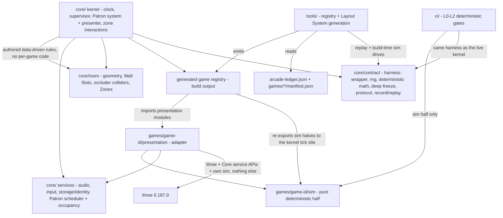
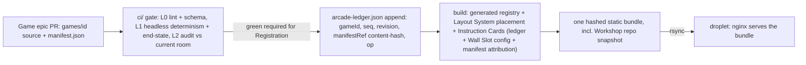
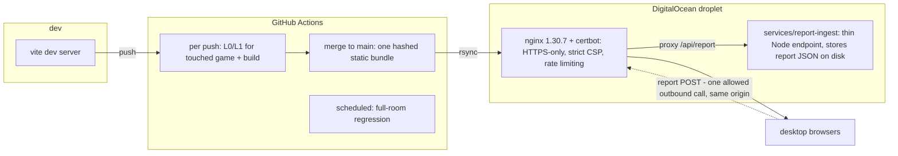

# Architecture Spine — Local Arcade

## Design Paradigm

**microkernel (plugin architecture).** The Arcade Core is the kernel: it owns a deterministic fixed-tick clock, the room, and all room services (audio, input, storage/identity, Patron scheduling). Games are two-part contract plugins — a pure deterministic sim half plus a presentation adapter. An append-only registration ledger feeds the game registry and the Layout System at build time. Deploy is one static bundle.

Paradigm → directories:

- Kernel → `core/` (scheduler, supervisor, patron system, services) and `core/room/` (geometry, Wall Slots, occluder colliders, Zones, zone interaction objects)
- Plugin sim half → `games/<game-id>/sim/`
- Plugin presentation half → `games/<game-id>/presentation/`
- Plugin descriptor → `games/<game-id>/manifest.json`
- Arcade history → `arcade-ledger.json` (repo root)
- Gates → `ci/`; generation utilities → `tools/`; factory skills → `.claude/skills/`

## Invariants & Rules

Dependency direction is a rule; the diagram shows allowed imports only — anything not drawn is forbidden (AD-1, AD-2, AD-7).



### AD-1 — Kernel/plugin boundary: Core imports no game code [ADOPTED]

- **Binds:** all; FR-8
- **Prevents:** games reaching into room internals; Core accreting per-game branches
- **Rule:** Core kernel imports no `games/**` source at authoring time; at runtime the only game-facing surface is the build-generated registry. A Game registers by manifest alone — zero Arcade Core code change. CI dependency check fails any Core→game import.

### AD-2 — Two-part Game plugin: sim half + presentation adapter

- **Binds:** FR-6, FR-17, every Game epic
- **Prevents:** game logic entangled with the render loop, making headless verification and deterministic autoplay impossible
- **Rule:** sim half imports no three/WebAudio/DOM/window modules; presentation adapter imports three + Core service APIs + its own sim only. CI, L1, `autoplay(seed)` and `stateHash()` import the sim half only. The one sanctioned shared harness for `ci/` and `tools/` is `core/contract/` — the contract wrapper, rng, deterministic math, deep-freeze, calling protocol, and record/replay core (AD-26) — never game presentation halves or game-internal modules. L0 lint enforces the per-half import bans. The contract must be wrappable around heterogeneous existing assets (Hall of Models tables), not only baked into new games.

### AD-3 — Core owns the clock: global fixed 60Hz tick

- **Binds:** all Games, L1/L2 determinism, Patron causality
- **Prevents:** per-game self-driving loops; frame-timing-dependent stateHash
- **Rule:** sims never call rAF/setInterval; the Core master loop drives one global 60Hz tick (games needing finer physics substep internally); sim time = tick count; `Date.now`/`performance.now` are lint-banned in the sim half. The no-self-drive and wall-clock bans cover BOTH plugin halves: an adapter derives all motion from sim state read at kernel tick time — no adapter-internal frame-driven animation.

### AD-4 — Seeded RNG injected by Core

- **Binds:** FR-17 determinism, autoplay(seed)
- **Prevents:** non-reproducible runs across games and CI reruns
- **Rule:** Core injects the rng at game instantiation. The seed is either **derived** (Manifest seed + instance role — attract and Patron instances) or **kernel-fresh random** (visitor-play instances — surprise preserved); the recording stores the *resolved* per-instance seed and replay never re-derives it (AD-26). `Math.random()` is lint-banned in the sim half. The rng's cursor is part of `snapshot()`, so replay and stateHash cover rng advancement exactly (AD-26). The sim's determinism surface is closed: rng plus a **Core deterministic math module** — engine-variable `Math` transcendentals (`sin`/`cos`/`tan`/`asin`/`acos`/`atan2`/`pow`/`exp`/`log`) are lint-red in the sim half, because browser-recorded runs must replay bit-identically on Node (`tools/replay`, L1).

### AD-5 — stateHash() is Core-provided

- **Binds:** FR-17, L1 determinism gate, attract-liveness checks
- **Prevents:** hand-rolled hashes making determinism incomparable across games (incl. pinball wrappers)
- **Rule:** `stateHash()` is implemented by the Core contract wrapper: it structural-hashes the plain serializable state the game exposes via `snapshot()` (canonical serialization → hash). A game's own `stateHash` implementation is lint-red. The wrapper computes it, so determinism is one comparable currency across every game, incl. pinball wrappers.

### AD-6 — Evented causality: sim events are the only channel a Game has; kernel events carry the rest

- **Binds:** FR-4, FR-5, Patron system, AD-25 Zones
- **Prevents:** cross-instance coupling that breaks determinism and the room audit; ad-hoc wiring between objects
- **Rule:** sims emit plain-data event lists each tick — that is the *only* channel through which a Game influences the room. Patron reactions and banter triggers consume those events verbatim from the same instance via the authored impulse stage (AD-23). Kernel-owned systems (Patron scheduler, zone interactions) emit the same kind of plain-data events on the same footing. No direct game-to-game or game-to-Patron calls. Kernel-consumed type names are CANONICAL and reserved: `gameEnded`, `roundBreak`, `scoreSubmitted` — every game must emit `gameEnded` or `roundBreak` to end an autoplay run; all other type names are game-local.

### AD-7 — Core owns all room services; games reach the room only via the adapter

- **Binds:** FR-3, FR-7, FR-11, every Game epic
- **Prevents:** per-game WebAudio graphs, storage sprawl, scattered input listeners; audio and visual seek drifting onto different geometry
- **Rule:** one Core Audio Manager owns the WebAudio graph — games supply assets+requests; the Manager does PannerNode spatialization, distance attenuation, and raycast occlusion (gain + lowpass) against the dedicated occluder collider set in `core/room` (single-ray first; soft multi-ray deferred). The same occluder set is the sightline-breaking reference for visibility/scene composition, so the whole pull-signal ladder (sound → attract flash → patron drama) rides one geometry. Channel budget = distance-cull + nearest-N (thresholds at M2). Active nodes always operate inside the awake set (AD-27) — a sleeping machine makes no sound, so proximity and visibility drive the mix for free. **Seated focus mix:** while a visitor is seated at a machine, the Manager applies an authored focus mix: focused cabinet at full level, every other cabinet's audio ducked to an authored floor (default near-silence — "tuned in"); ambience and zone sound follow their own authored levels. Mix state derives solely from kernel tick state (occupancy, positions, camera) — never wall-clock. Core owns physical-device capture (pointer-lock look, keys, mouse buttons) and maps it onto each game's **declared control scheme**: the Manifest names that game's axes/buttons/aim slots (AD-12), and the kernel routes the bound input data object into the game tick. Slot **kinds** carry a fixed value grammar, pinned by the `ci/` schema and validated at L0 (`controls.vocab` versioned): `axis` = number ∈ [-1,1] level signal; `button` = `{down: boolean, pressed: boolean}` per-tick (level + rising-edge flag); `aim` = `{dx, dy}` per-tick deltas. The scheme vocabulary is **additive** — future primitives (spinner, twin-stick, extra buttons) extend it as new kinds without breaking any existing game; a game only ever reads its declared slots from the tick input object and never sees devices. L0 lint bans direct WebAudio, `localStorage`, and window input listeners in the adapter half.

### AD-8 — Game-build contract: verbatim hooks + Manifest + four-layer gate [ADOPTED]

- **Binds:** FR-17, all Registrations
- **Prevents:** liveness-free games (presentation tables are Dead Machines by law without hooks); non-conforming registration
- **Rule:** contract = hooks `attract()` / `autoplay(seed)` / `events()` / `stateHash()` (names verbatim in code) + schema-valid Manifest. Layers, all deterministic scripts, zero LLM tokens:
  - **L0** lint (import bans, banned APIs) + Manifest schema.
  - **L1** headless (no browser, seconds): same seed → same stateHash; attract liveness (stateHash advances each attract cycle); seeded autoplay runs **to a real end state** — it must emit canonical `gameEnded` or `roundBreak` (AD-6) before terminating (this is what makes "busy is a texture, not a lock" provable); **sealed-build check** — static scan + no-network sandbox run prove zero outbound network/model calls from the bundle except the single named same-origin report POST (AD-26) (the thesis, CI-enforced; deployment re-verify in AD-20).
  - **Calling protocol (seam semantics):** the kernel drives sims through the build-generated registry (see dependency diagram): per tick it calls `tick(dt, input)` with constant dt = 1/60 tick units, then calls `events()` to pull that tick's plain-data list; `attract()` and `autoplay(seed)` are one-shot kernel-initiated mode switches; the supervisor wraps every kernel call site. `stateHash()` is computed by the wrapper (AD-5).
  - **L2** room audit vs *all* placed Cabinets: dead-machine detector (stateHash-delta per attract cycle), screenshot-test proxy (sampled frame differs from prior frame) + framerate floor, Patron causality probe (reaction fires 1:1 with its sim event within the reaction window), character lint (AD-24), aisle-nav lint (every aisle and slot approach walkable).
  - **L3 human walk** — final, irreducible: builder walks the build; SM-1 (first minute by ear) and SM-4 (feels like the memory) have their named seat here.
  Per story: L0–L1 for the touched game. Pre-Registration: L0–L2 vs the current room; Registration refuses a red gate. Scheduled: full-room L1–L2 regression.
  `presentationOnly` machines (museum class, AD-12): `autoplay()` may be absent — but the sim half must still be the *real per-tick model of everything the presentation shows* (a museum sim with no human controls); autoplay is absent because there is no end state, not because there is no sim. L1 enforces attract liveness + determinism only; no Patrons seat at them.

### AD-9 — Registration = manifest commit; append-only ledger [ADOPTED]

- **Binds:** FR-8, FR-9, FR-16
- **Prevents:** using git order (rebase/squash/cherry-pick) as the arcade's order record; id churn breaking score continuity
- **Rule:** the ledger is STRICTLY append-only — every change is a new row `{gameId, seq, revision, manifestRef, op}`, `op ∈ registered | refurbished | removed`; the highest revision wins. Refurbish = a new `refurbished` row (same Game id, same slot); de-registration = a `removed` row (slot returns to the pool); no relocation in v1. `manifestRef` is the manifest file's content hash (drift and tamper are detectable); `seed` lives ONLY in the Manifest, never the ledger. `tools/` validates the ledger at build: monotonic rows, hash match, one winner per id.

### AD-10 — Layout System is a pure build-time function [ADOPTED]

- **Binds:** FR-10, FR-2, FR-11
- **Prevents:** nondeterministic rooms; runtime rearrangement
- **Rule:** placement = pure function of (ledger + `core/room` Wall Slot config), computed at build time — same registration history → same room. Wall Slots are pre-declared and evenly spaced; fill is back→front alternating left/right; the room never auto-rearranges. Zones (Workshop, Snack Bar, Pinball Corner) are fixed room architecture, never placed by the Layout System; machine positions *inside* a Zone (e.g. pinball tables in the corner) are fixed authored data in `core/room` — a Zone machine registers via manifest but its position is architecture, not layout output.

### AD-11 — One build: source + Manifest in, one static bundle out

- **Binds:** FR-8, FR-12, deployment
- **Prevents:** runtime-loaded game artifacts (fetch surface, versioning, sealed-build policing)
- **Rule:** build reads all manifests + the winning ledger revision per id, generates the game registry, placements, and Instruction Cards (AD-24), and bundles one static site. `buildRef` = the commit that introduced the game; the currently-served build derives from the build's git snapshot (Workshop commit-log truthfulness for free).

### AD-12 — Manifest: JSON + Schema, written by the Registration skill

- **Binds:** FR-8, FR-9, FR-11, FR-13, L0
- **Prevents:** hand-edited manifests drifting; attribution data scattered per-story
- **Rule:** required fields (PRD-delegated to architecture): `id` (= kebab-case Game id), `title`, `originalYear`, `attribution` (model name(s) + build provenance), `cabinetType` (stand-up | sit-down), `seed` (sole seed source, AD-9), `busy` (desired busy-presence for the Patron scheduler), `controls` (declared control scheme: named axes/buttons/aim slots, AD-7), `scoreHigherIsBetter`, `rulesText` (asset path; feeds the generated Instruction Card), `buildRef` (stamped by the skill: the introducing commit), optional `presentationOnly: true` (museum class, AD-8). Schema lives in `ci/`+`tools/`, machine-validated at L0; manifests are produced by the Registration skill, never hand-written. Attribution flows one way: Manifest → generated Instruction Card / nameplate.

### AD-13 — Monorepo

- **Binds:** all
- **Prevents:** split repos breaking whole-room L2 regression, Workshop repo-truth, and the one-droplet build
- **Rule:** one repo holds `core/`, room assets, `games/<game-id>/`, `ci/`, `tools/`, and the factory skills. Separate game repos are rejected.

### AD-14 — TypeScript at the Core + contract seam; Games may be plain JS

- **Binds:** Core, Game-build contract, FR-6 (Moon Patrol wrap)
- **Prevents:** framework churn taxing independent Game epics
- **Rule:** Core and the contract seam are TypeScript; a game may be plain JS with JSDoc — the contract is enforced at the seam regardless of game language. The existing Moon Patrol clone is vendored into `games/moon-patrol/` (monorepo, AD-13) and wrapped to the contract for M0; its reimplementation to the standard stays FR-6's plan — wrap-vs-rewrite is not a repo-topology question.

### AD-15 — Sim state mutated only inside tick(); Core supervisor contains faults

- **Binds:** FR-5, all Games
- **Prevents:** one faulted game crashing the room — or a fault silently creating a Dead Machine
- **Rule:** no sim-state mutation outside `tick()` — enforced mechanically: the L1 harness and the dev kernel deep-freeze sim state between ticks, and an out-of-tick write throws (red gate / fault). The Core supervisor catches sim errors — a faulted game is logged as a Dead-Machine defect but its Cabinet keeps performing (fallback marquee + screen motion driven by the kernel, no sim needed): the no-dead-machines law holds even under fault; the room never crashes.

### AD-16 — Anonymous identity only: visitor UUID, no auth, no PII [ADOPTED]

- **Binds:** FR-7, OQ-8, NFR public posture
- **Prevents:** account/auth sprawl; persistence keyed on unstable ids breaking refurbish continuity
- **Rule:** Core generates an anonymous visitor UUIDv4 in `localStorage` under the `arcade.*` namespace and exposes a namespaced storage service; games report scores only via the canonical `scoreSubmitted` event, payload `{score: number, initials?: string}` — if the game supplies no initials, the kernel derives an anonymous pseudonym. The Cabinet's in-game score table (Personal Bests + Patron auto-play runs) is Core-owned and delivered **read-only to the Cabinet's presentation half** through the Core storage service (rendered from the adapter at tick time) — it is never in the sim's input, and the sim never branches on or stores score-table content (L0: reading the score service from the sim half is red). This keeps visitor-keyed state out of sim state, out of `stateHash`, and out of Run Recordings (AD-26). The sim's tick input object carries exactly one field, `controls` — that game's declared-scheme state (AD-7) — nothing else is injected. Personal Best is keyed (stable gameId, visitorId) — refurbish continuity is free. Global leaderboards out of v1.

### AD-17 — Desktop-only [ADOPTED]

- **Binds:** FR-1, input, CI targets
- **Prevents:** mobile input modes multiplying the contract surface
- **Rule:** input surface is mouse-look + WASD only; no phone/tablet support anywhere. Target matrix: enforced = evergreen Chrome + Edge (desktop); compat target = Firefox; Safari (desktop) best-effort, its enforcement deferred to the M2 health-check. CI runs against the enforced targets.

### AD-18 — Deterministic runtime, sealed build, no runtime LLMs [ADOPTED]

- **Binds:** thesis, NFR, all
- **Prevents:** model-call nondeterminism; unsealed artifacts in prod
- **Rule:** zero LLM/model calls at runtime and in CI (CI is deterministic scripts, zero tokens); the prod artifact is one sealed static bundle verified before it ships. The sealed property admits exactly **one named exception**: the same-origin report POST (`/api/report`, AD-26) — any other outbound call fails the check.

### AD-19 — Games are native in-scene modules in one runtime; never iframes [ADOPTED]

- **Binds:** OQ-6, security posture
- **Prevents:** sandbox boundaries that make hooks/autoplay/stateHash impossible
- **Rule:** no iframe/webview embeds in the room; an external, non-conforming game simply cannot register.

### AD-20 — Static deployment envelope [ADOPTED]

- **Binds:** NFR §6, FR-1, infra
- **Prevents:** backend sprawl at cold start; environment divergence
- **Rule:** prod = one DigitalOcean droplet; nginx + certbot; HTTPS-only; strict CSP, single-origin, zero external scripts (donation links are in-world top-level navigations); nginx rate limiting; input validation on any data the room sends out. nginx also proxies `/api/report` to the thin report-ingest service on the same droplet (AD-26) — the room's one allowed outbound call. GitHub Actions: per-push L0/L1 for the touched game + build; merge to main builds one hashed static bundle, re-verifies the sealed-build property (AD-8 L1 check against the final bundle) before rsync to the droplet; scheduled full-room regression. Same artifact dev → CI → prod. The droplet is disposable — the repo is the state.

### AD-21 — Workshop reflects the repo [ADOPTED]

- **Binds:** FR-12, M4
- **Prevents:** the room lying about the workshop's history; two stories choosing different state sources for the bench
- **Rule:** the build bakes a Workshop snapshot into the bundle as data: `{git log, CI test/build status (from the build run + last scheduled regression), ledger, plans inventory (planning docs in `_bmad-output/`)}`. Machine lifecycle staging is a mapping from that snapshot: plan-only → chalk outline + plan drawer; source present + red gate → bare cabinet skeleton + work light; tests-green pre-Registration → bench art + TESTED tag (first attract on the bench); registered → installed. Card↔drawer pairing: every ledger entry generates both its Instruction Card and its plan-drawer entry. Plans for unbuilt machines are staged legibly as unbuilt. "Repo change → room change within one build."

### AD-22 — Snack Bar donations: offer-not-confirmed [ADOPTED]

- **Binds:** FR-13, M5
- **Prevents:** fake donation theater
- **Rule:** tip jar clinks locally (no network); BMC and crypto are top-level navigations only; the room stages donation state honestly as unconfirmed. The PRD's completion-signal consequence has no v1 mechanism (no free-tier BMC webhook, no backend): the honest fallback above *is* the v1 answer; completion updates return with the deferred backend (Deferred).

### AD-23 — Patron system: busy machines are real autoplay; the queue is kernel-owned and deterministic

- **Binds:** FR-4, FR-5, M0, M2
- **Prevents:** stories inventing incompatible busy/queue semantics; a machine permanently withheld; nondeterministic room state breaking regression and random-frame audits
- **Rule:** a busy Cabinet is one where a Patron is playing via its game's own `autoplay(seed)` path (no separate "busy animation"). Occupancy + queue state live in the kernel Patron scheduler (`core/`) and are tick-deterministic (seeded) like everything else. The Manifest's `busy` field declares desired busy-presence. Input arbitration belongs to the kernel: at a busy machine the visitor may wait, take over at `gameEnded`/`roundBreak` (guaranteed by L1 end-state, AD-8), or walk away — busy is never permanent. Takeover precedence at a break: a physically-present visitor beats the queue head. In-tick phase order is fixed: sim ticks → event dispatch → scheduler decisions → input routing for the next tick. Patron→Patron handoff (waiting Patron sits, departing Patron lifts off) is scheduler-driven state. The reaction path is: sim event → authored per-game impulse mapping (data asset) → kernel reaction library (flinch/slam/jump, `core/patrons/` data) → **kernel Patron presenter** animates the figure. A game's adapter animates only its own Cabinet (screen/marquee/audio) — it never poses a Patron figure. Banter is fixed authored dialogue-tree data triggered by events, never generated. Seated play does not pause the room; standing up returns the visitor to their position (FR-6 continuity).

### AD-24 — Diegetic integrity: the arcade never breaks character

- **Binds:** FR-9, FR-2, M2, M3; the found-never-announced law
- **Prevents:** HUD/waypoint creep; attribution leaking onto signage; cards with nothing generating them
- **Rule:** every text surface in the room declares a kind (marquee | instruction-card | nameplate | room-sign) — the lint-able whitelist. Marquees show the game title only. Model attribution appears only on Instruction Cards and Hall of Models nameplates. No non-diegetic UI anywhere: no HUD markers, waypoints, hints, or guided order. Instruction Cards are generated at build time from Manifest attribution + the game's rules text (AD-11, AD-12). L2 character lint fails any undeclared surface, off-whitelist attribution, or UI marker.

### AD-25 — Zones and fixtures are kernel interaction objects, not Games

- **Binds:** FR-2, FR-12, FR-13, coin-door cards, M4, M5
- **Prevents:** stories inventing ad-hoc interaction mechanics for non-game objects; the tip-jar clink having no owner
- **Rule:** Zones (Workshop, Snack Bar, Pinball Corner) and fixtures (coin door, desk, counter, door, report fixture) are interaction objects owned by `core/room`, behaving by deterministic authored data-driven rules — no manifests, no layout placement (AD-10), no game code. Fixtures own their interaction state, including the honest donation staging of AD-22 (the single owner the L2 audit reads). Their interactions emit kernel events (AD-6) that drive the same consumers (Audio Manager → the clink; lines from authored data). Every rendered *figure* — including the Snack Bar attendant — is drawn by the kernel Patron presenter via a figure-request service; fixture dialogue is authored `core/room` data consumed by the same dialogue stage that serves Patron banter. Zone behavior is zero-LLM and tick-deterministic.

### AD-26 — Reproducible runs: kernel-owned Run Recording, replay, and reporting (FR-18)

- **Binds:** FR-18, AD-4, AD-5, AD-8 (seed + inputs + stateHash already make every run replayable), AD-16, AD-20
- **Prevents:** every game inventing its own debug trace (unauditable, divergent from the replay contract); bug reports that can't reproduce; replay implementations that drift from the game's real semantics
- **Rule:** the kernel records every game instance it drives — visitor or Patron — as a **Run Recording**: `{gameId, bundleRef, seed, inputChanges (tick-indexed), periodic + final stateHash}`. `bundleRef` = the served bundle's git snapshot (AD-20/AD-21) that produced the run — distinct from the Manifest's `buildRef` (the commit that introduced the game). The sim sees only the resolved seed + declared-slot inputs (never score-table or visitor-keyed state, AD-16), so recording + replay reproduces the run exactly under the AD-8 calling protocol; periodic hashes localize where a replay diverges. Replay uses the recorded seed verbatim and never re-derives (AD-4). **PII never appears in a recording — not even the visitor id** (AD-16). Games never log or replay their own runs; the kernel owns both (the L0 `localStorage` ban already enforces this).
  - **Fault sealing:** if the supervisor catches a sim fault mid-run (AD-15), the recorder seals the recording at the last good tick with a fault marker `{tick, errorId, lastGoodHash}` — kernel fallback frames are never recorded, and the final hash is the last-good hash. A replay counts as reproducing the fault when the same fault marker fires at the same tick from the same seed + inputs. L2's dead-machine detector treats a Cabinet carrying a live fault marker as a **named Dead-Machine defect** judged by the frame-diff proxy, not by stateHash-delta.
  - **Storage:** a ring under the `arcade.rec.*` key prefix; eviction never touches identity or personal-best keys, and a placed Cabinet's most recent recording is never evicted while it stays placed — "the current recording" the reporting fixture offers is that one. Byte budget and periodic-hash cadence are single global config, set at M2; recording writes are batched outside the tick budget.
  - **Replay (v1):** `tools/replay <recording>` re-drives a run headless through the **Core contract harness** (`core/contract/`: wrapper, rng, deep-freeze, calling protocol, recorder/replayer core — AD-2), the same seat L1 determinism reuses, so replay hashes are the same currency as in-room hashes. In-room playback is a kernel-driven instance kind (`replay`) mutually exclusive with that Cabinet's attract/autoplay/play: the incumbent instance's recording seals, the replay instance counts for liveness (its stateHash advances), and playback runs to the recording's sealed end — final hash or fault marker — then the Cabinet returns to attract. Playback is entered by the visitor only; the scheduler never initiates it. A takeover at a break seals one recording and opens the next under the new instance — the Cabinet's latest is always what gets reported.
  - **Reporting (v1):** the diegetic affordance — "something's wrong with this machine" (fixture placement is story-time) — offers the current recording as a downloadable JSON **and** a submit action: a POST to the arcade's own same-origin ingest endpoint (`/api/report`), where reports are **recorded server-side** (owner requirement 2026-11-20). The ingest service is thin: `services/report-ingest/` in the same repo, Node stdlib only, no auth, size-capped, rate-limited, stores report JSON on droplet disk; the builder pulls reports and replays each with `tools/replay`. Payload = `{recording, note?}` — the note is optional untrusted free text, never rendered in the room. This POST is the bundle's **one named outbound-call exception** (AD-18, AD-20); everything else stays silent. The repo's new-issue page remains available as a top-level navigation (AD-20 posture, same as donations). The reporting affordance is an AD-25-owned fixture (a claim-check / "out of order" card at the Cabinet; exact placement is story-time); it owns its staging state like the tip jar owns its clink, and its signage is a `room-sign` surface (AD-24).

### AD-27 — Liveness tiers: sim advance by a tick-derived wake set (scale law)

- **Binds:** NFR performance (modern laptops), FR-15/SM-C2 framerate floor, AD-3, AD-7, AD-8 (L2 audit), AD-23
- **Prevents:** dozens of always-running 60Hz sims collapsing the room loop; audio nodes attached to sleeping sims; culling that quietly breaks determinism, replay, or the no-dead-machines law
- **Rule:** sim advance is tiered by an **awake set**, recomputed each tick: (a) every visitor-occupied instance — always awake; (b) every instance within a near radius or inside the camera frustum plus an authored margin — *visible ⇒ awake*, so the no-dead-machines law is never traded for framerate; (c) everything else sleeps at an **idle pulse**: a fixed shared cadence (each pulse advances the sim one tick — dilated time), so Patron autoplay and busy/queue resolution never starve unobserved. Wake/sleep is a **pure function of tick state** (camera, positions, occupancy) — never wall-clock, never view-count heuristics from outside the tick — so a replay reproduces the identical wake schedule and stateHashes (AD-26). Audible ⇒ awake: the Audio Manager's distance-cull + nearest-N budget (AD-7) operates inside the awake set. Headless L1/L2 runs disable culling entirely (**audit mode**): determinism gates and room audits always see the unculled room. All numbers — near radius, frustum margin, pulse cadence, audio N — set at M2 (Deferred).

### AD-28 — Fallback-face score-row fit law: the attract block yields to score rows [ADOPTED 2026-11-24, story 1.8, unattended ruling (veto)]

- **Binds:** FR-7 (the Cabinet's score table renders read-only), 1.4's screen law, 1.7's fallback-face law
- **Prevents:** the score zone 1.4 reserved for 1.8 being un-paintable — measured: on the authored 0.44x0.52m B0 fallback face the row-0 baseline (399) collides with the NEXT row's top (330) the moment ANY row exists, so every paint step of a faulted Cabinet's face would throw and flood the fault ring; and quiet layout hacks that break the 1.4 pins or the 0.18m NEXT floor
- **Rule:** when a Core-painted fallback face's score zone carries rows, `drawScreen` omits the attract title block and paints the rows below the live scan band: at most **2** rows on the authored B0 face at the 0.08m cap (baselines 177/309; a 3rd collides with the 0.18m NEXT floor — the collision law stays the loud guard). The Core table service caps its view at 2 rows (Personal Best + best Patron run; Patron-only view keeps best 1). With an empty zone the face paints byte-unchanged (CAP-8 honesty, 1.4 pins byte-unchanged). The scan band, NEXT floor, composite-face law, placements, collision volumes and all authored constants are untouched. Measured, not inferred: executed probe of the real painter against authored B0 data, 2026-11-24.

## Consistency Conventions

| Concern | Convention |
| --- | --- |
| Naming | Game id = kebab-case = directory name = Manifest id, stable across refurbish; contract hooks verbatim `attract()` / `autoplay(seed)` / `events()` / `stateHash()` |
| Data & formats | Manifest = JSON, JSON Schema-validated at L0 (required fields in AD-12); ledger row `{gameId, seq, revision, manifestRef (content hash), op}`, strictly append-only (AD-9); sim/kernel events = plain-data `{type, payload}`, camelCase — canonical reserved types `gameEnded`, `roundBreak`, `scoreSubmitted` (AD-6); stateHash over canonically serialized plain `snapshot()` (AD-5) |
| Discovery ladder | Pull-signal order is fixed: occluded spatial sound → attract graphics → Patron/player intensity; zero UI hints anywhere (AD-24) |
| Authored behavior data | Patron reaction library in `core/patrons/` data; per-game event→impulse mapping + dialogue trees are game data assets consumed by the kernel (AD-23) |
| State & mutation | Sim state mutated only inside `tick()`; sim time = tick count; rng and input injected by Core; no `Math.random`/`Date.now`/`performance.now` in sim half; engine-variable `Math` transcendentals replaced by the Core math module (AD-4); rng cursor lives inside `snapshot()`; the sim's tick input carries only the `controls` field — score tables render in the presentation half (AD-16) |
| Run recording & replay | Recording = `{gameId, bundleRef, seed, inputChanges (tick-indexed), periodic + final stateHash}` (bundleRef ≠ Manifest buildRef), ring under `arcade.rec.*`, latest per placed Cabinet never evicted, PII never included; fault-sealed recordings carry `{tick, errorId, lastGoodHash}`; replay headless (`tools/replay`, via `core/contract/`) and in-room as a `replay` instance kind on the cabinet screen; submit = size-capped same-origin POST `/api/report`, no auth, note untrusted and never rendered in-room; games never self-log or self-replay (AD-26) |
| Controls | Per-game control scheme declared in the Manifest (named axes/buttons/aim slots); kernel maps devices to it; vocabulary additive — new primitives never break existing games (AD-7, AD-12) |
| Liveness & culling | Awake set = visitor-occupied ∪ near-radius ∪ in-frustum(+margin); the rest idle-pulses at a shared cadence; wake decisions pure tick-state functions; audible ⇒ awake; culling disabled in headless audit mode (AD-27) |
| Audio mix | Distance attenuation + raycast occlusion on the one occluder set; seated focus mix ducks non-focus cabinet audio to an authored floor; mix derived only from tick state (AD-7) |
| Faults | Core supervisor catches sim faults → Dead-Machine defect logged; Cabinet keeps performing via kernel fallback (AD-15) |
| Identity & storage | Visitor id = UUIDv4 in `localStorage` under `arcade.*`; Personal Best keyed (gameId, visitorId) with initials + score; games use the Core storage service only |
| Attribution flow | Manifest `attribution` is the single source; build generates Instruction Cards and nameplates from it (AD-24) |
| Room geometry & collision | `core/room/` owns the room as authored data: one AABB volume list (ids stable, `{id, min, max, blocksMovement, targetable, kind}`) is the single source for movement blocking (1.2 placeholders → 1.3 authored room), the occluder set for audio raycasts, and visual extrusion — collision/render code never hardcodes geometry; the resolver is code, the volumes are data, and 1.3 rewrites the data in place |
| Auth | None anywhere |

## Stack

Seed — name + pinned version only; all web/npm-verified 2026-11-19 and re-verified by the review gate. The code owns this table once it exists. Hand-coded three.js on Vite+npm is the going 2026 default (official three.js manual); react-three-fiber is deliberately not used — a React reconciliation layer fights the fixed-tick deterministic model.

| Name | Version |
| --- | --- |
| three (renderer) | 0.187.0 |
| @types/three (three ships no bundled types) | 0.187.0 — must match three exactly |
| TypeScript (Core + contract seam) | 7.0.2 |
| Vite (build) | 8.3.8 |
| Node (toolchain, test runner) | 26 (Active LTS; 26.13.x) |
| nginx (prod) | 1.30.7 stable — must be ≥1.30.7 (NGINX2Root fixes, 2026-11-18); install from the upstream nginx repo, not distro backports (which keep stale version strings) |
| report-ingest service (prod, thin) | Node 26.13.x — `node:http` stdlib only, no framework (AD-26) |
| GitHub Actions (CI) | hosted — pin actions to commit SHAs at workflow-authoring time |
| DigitalOcean droplet (prod host) | static nginx host — unpinned |

## Structural Seed

```text
local-arcade/
  core/                  # kernel: loop scheduler, audio manager, input, storage/identity,
                         # registry + layout generation, patron system (+ patrons/ data),
                         # supervisor, lint sets
    room/                # hand-designed geometry, Wall Slot config, occluder collider set,
                         # Zones + zone interaction objects
    contract/            # harness shared by kernel, ci/, tools/: wrapper, seeded rng, deterministic
                         # math, deep-freeze, calling protocol, record/replay core (AD-26)
  games/
    <game-id>/           # kebab-case id = dir name = manifest id
      sim/               # pure deterministic half: tick(dt, input), seeded rng, events
      presentation/      # three adapter binding sim state to visuals/audio
      manifest.json      # JSON Schema-validated, written by the Registration skill
      assets/            # incl. authored impulse mapping + dialogue trees
  ci/                    # deterministic L0-L2 gate scripts + manifest schema (zero LLM tokens)
  tools/                 # ledger + build utilities (registry, placement, card generation), replay harness
  services/
    report-ingest/       # thin same-origin report endpoint (AD-26): Node stdlib, stores report JSON
  .claude/skills/        # 5 Game Factory skills: pipeline-init, metadata, contract-test,
                         # health-check, registration — thin orchestrators; all mechanics they
                         # run live in ci/ and tools/ (skills contain no gate logic)
  arcade-ledger.json     # append-only registration history (repo root)
```

Registration → placement → build:



Deployment topology:



## Capability → Architecture Map

| Capability / Area | Lives in | Governed by |
| --- | --- | --- |
| Walk-in shell (FR-1, FR-2) | `core/` kernel (60Hz loop, first-person shell), `core/room/` | AD-1, AD-3, AD-17, AD-20; time-to-playable budget deferred (Deferred) |
| Living machines / find-by-ear (FR-3, FR-5) | Core Audio Manager + occluder colliders; attract hooks; liveness checks | AD-7, AD-8, AD-15; thresholds deferred |
| Busy machines / queue ritual (FR-4) | `core/` Patron scheduler + occupancy; autoplay instances; authored impulse/dialogue data | AD-23, AD-6, AD-4 |
| Play in place (FR-6, FR-7) | `games/*/sim/`; Core storage/identity service; seat transition in kernel | AD-2, AD-3, AD-16, AD-23 |
| Registration + lifecycle (FR-8, FR-16, FR-17) | `manifest.json` + source commit, `arcade-ledger.json`, Registration skill, `ci/` gates | AD-8, AD-9, AD-11, AD-12 |
| Attribution + character integrity (FR-9) | Generated Instruction Cards / nameplates; L2 character lint | AD-24, AD-12, AD-11 |
| Layout System (FR-10) | Layout generation in `tools/` at build time; Wall Slot config in `core/room/` | AD-10 |
| Standard cabinets (FR-11) | Standard stand-up/sit-down shells as room architecture; `cabinetType` in Manifest | AD-10, AD-12; custom models deferred |
| Workshop (FR-12) | Workshop zone + build-time repo snapshot; staging mapping | AD-21, AD-25, AD-11 |
| Snack Bar (FR-13) | Snack Bar zone interaction objects; donation navigations | AD-22, AD-25, AD-20 |
| Pinball Corner + Hall of Models (FR-14, FR-15) | Fixed Pinball Corner zone; pinball as contract wrapper (M6); presentation tables as `presentationOnly` wrappers with liveness hooks now | AD-2, AD-8, AD-12, AD-10; engine deferred |
| Reproducible runs: recording, replay, reporting (FR-18) | `core/contract/` harness + kernel run recorder; `tools/replay`; reporting fixture (`core/room`); `services/report-ingest/` (server-side record) | AD-26, AD-4, AD-5, AD-8, AD-16, AD-20 |
| Performance at scale (NFR §6, FR-15) | kernel wake-set computation in the loop scheduler (`core/`); audit mode in `ci/` | AD-27, AD-3, AD-7 |
| Public posture (NFR §6) | nginx/CSP/rate-limit config; sealed CI bundle | AD-18, AD-19, AD-20, AD-16 |

## Deferred

- **Pinball engine + first playable table** (OQ-4) — revisit when M6 opens for story-scoping. That story must also settle what the engine decision carries: packaging form inside the sim half (WASM vs port vs rewrite), license obligations inside a distributed sealed static bundle (GPL candidate engines), and cross-browser physics determinism beyond same-seed-same-hash (L1 runs one environment). The Hall of Models presentation tables are NOT deferred: they register as `presentationOnly` wrappers with liveness hooks (AD-8/AD-12) or they are Dead Machines by law.
- **Thicker backend API** — the minimal report-ingest endpoint (AD-26) is **v1, not deferred**; anything beyond it returns only for (a) donation-completion polling (BMC supporter feed) → its own later epic; (b) leaderboards / multiplayer → post-M6. Report triage stays manual (pull + replay) until an epic says otherwise.
- **Soft multi-ray audio occlusion** — single-ray first (AD-7); revisit when occlusion quality/perf demands it.
- **Numeric thresholds** — framerate floor (FR-15/SM-C2), audio channel budget (distance-cull/nearest-N), seated focus-mix duck levels, wake-set near radius / frustum margin / idle-pulse cadence (AD-27), Patron reaction window: set at M2 when the health-check skill is built. Not deferred: attract liveness is enforceable now via stateHash-delta (AD-8 L1); only the pixel/fps/reaction-window numbers wait for M2. Until they land, the full no-dead-machines law is not CI-enforceable; M2 acceptance is incomplete without them.
- **Time-to-playable budget** — **CLOSED at story 1.9's smoke (2026-11-25, lead Rule-20 write).** FR-1's ≤60s stays the guardrail ceiling, not a target: the shell's first measurement is ~4.9 s to control on dev-serve desktop Chrome (`timeToPlayableMs` 4948.5) and ~16.8 s on headless SwiftShader Edge (16775) — one-canvas page, zero markup, entry beat included. No tighter M0 number is set; the framerate-floor numbers remain deferred to M2 (this row's other half).
- **Marquee name of the arcade** (OQ-9) — revisit at launch prep. Not to be confused with per-cabinet marquees, which display `Manifest.title` from M0 (AD-24).
- **Cabinet relocation** — no moves in v1 (FR-16); any relocation is a future epic.
- **Room growth** — its own epic when Wall Slots run out (FR-10).
- **Custom cabinet models** — allowed only within a game's epic; the two standard shells remain the default (FR-11); any custom model must fit the pre-declared Wall Slot geometry (AD-10).

This spine will NOT decide: epic/story breakdown or sequencing, room dimensions and art content, per-game internal design, anything whose revisit condition above hasn't fired, and any threshold marked "set at M2".
